# Seven-day kinetic crown + evidence-horizon gallery

**Implementation branch:** `feature/seven-day-animated-banner-cycle-20261012` · **Source PR:** [#1632](https://github.com/portyu9/portyu9/pull/1632). This gallery is a permanently reviewable catalog; production selection is governed by the accepted main-branch Spotlight image publisher.

Each of the seven themes is a designed **triplet**, not a recoloring: wide desktop crown (`1280×258` viewBox), simplified compact mobile crown (`640×196`), and matching closing horizon (`1280×150`). All artworks are self-contained vector XML with SMIL motion, `prefers-reduced-motion` static fallbacks, low-kilobyte payloads, and the established aqua / magenta / green brand family.

**Selection invariant:** `floor(UTC unix seconds / 86400) modulo 7`. One UTC day chooses **one** scene for all three images. No per-visitor JavaScript, randomized selection, mutable index state, or local timezone assumptions.

**Publishing safety:** GitHub README rendering cannot inspect the date from embedded SVGs. The read-only `scripts/banner_rotation.py` computes bounded, replay-safe README changes. The protected `scripts/spotlight_profile_links.py` renderer pins the helper and catalog to exact Git blob identities **before importing executable helper source**. It uses the verified published Spotlight manifest's `selection_date_utc` and proposes one atomic README-only update; the existing `spotlight-link-sync.yml` approval, attestation, PR and merge transaction publishes it. The independent signed `generated` evidence branch is **not** modified by banner rotation.

## 01 · Orbital Relay

Interlocking phase-space rings, synchronized aperture signals.

**Wide crown**


**Mobile crown**


**Closing horizon**


## 02 · Prism Vault

Nested trapezoidal perspective and optical depth lattice.

**Wide crown**


**Mobile crown**


**Closing horizon**


## 03 · Neural Weave

Connected attribution nodes with pulsing evidence synapses.

**Wide crown**


**Mobile crown**


**Closing horizon**


## 04 · Spectral Tides

Layered interference waves, spectrometer trace energy.

**Wide crown**


**Mobile crown**


**Closing horizon**


## 05 · Fractal Iris

Radial crystalline blades around a rotating verification iris.

**Wide crown**


**Mobile crown**


**Closing horizon**


## 06 · Circuit Basilica

Mirrored photonic circuitry and architectural port geometry.

**Wide crown**


**Mobile crown**


**Closing horizon**


## 07 · Singularity Mesh

Warped gravitational field lines and an event horizon core.

**Wide crown**


**Mobile crown**


**Closing horizon**


## Safety and rollout gates

- Preserve the canonical current README while the daily publisher is not yet authorized and validated.
- Use the existing governed, exact-head reviewed README-only Spotlight synchronization lane. The protected renderer expansion is measured and authorized on `main` separately (authorization PR #1635), without any new workflow/job permission, API write, scheduling trigger, secret, or subject contract.
- At each successfully published UTC day, validate the same scene slug in top desktop, mobile compact, and bottom references; reject stale day/date rollback, duplicate/malformed markers, external image/script resource URLs, and unchecked animated payload growth. The published Spotlight date is the explicit rotation source, so if evidence refresh is delayed, the last approved artwork remains (no unverified fast-forward).
- Retain a deterministic, identity-pinned candidate, full required CI, review, authorization receipt, and an auditable merged PR for the daily update; no silent self-merge or secrets in public SVGs.
- GitHub's existing hourly profile publication plus Spotlight synchronization are best-effort rather than a strict 00:00 UTC clock. Selection is deterministic and advances by one scene per UTC calendar day **when the new day's attested publication succeeds**; delayed, failed or cached GitHub views may continue showing the previous scene. No unsupported exact-midnight/24h SLA is claimed.
- Test Safari, Firefox/LibreWolf, Android Chrome and mobile Safari at representative widths, plus light/dark and prefers-reduced-motion. CI validates XML safety, complete asset inventory, bounded byte size, deterministic day boundaries, and governed code integrity but does not substitute for pixel-level captures.

### Local review commands

```bash
python3 scripts/banner_rotation.py --self-test
python3 scripts/banner_rotation.py --check
python3 scripts/banner_rotation.py --select --date 2026-10-12
python3 scripts/banner_rotation.py --propose --date 2026-10-12 > /tmp/banner-readme-proposal.md
python3 scripts/validate-profile-v4.py
```

The `--propose` command emits a candidate to stdout, **never writes README.md**. The emitted proposal is not an authorization to bypass protected review.
