# Banner V2 — seven cinematic kinetic artworks (review only)

> **Not deployed.** This is an artwork-review PR. The v1 seven-scene rotation, original Quantum Apex and Evidence Horizon SVGs, banner selection catalog, and protected README publisher are **unchanged**. Do **not** merge before visual approval. A separate reviewed deployment will update the catalog/pinned identities/authorization as necessary.

All artwork is generated reproducibly by `node scripts/generate-banner-v2.js --write`. `--check` asserts bit-for-bit equality. Artwork uses aqua, magenta, electric cyan, violet and deep black; all assets are self-contained SVG, no external requests, no JS and a reduced-motion alternative. Density/quality need human browser review, not just CI.

## Orbital Relay

Interlocked plasma orbits, communication apertures and beam relays

**Desktop crown 1280 × 258**

**Mobile crown 640 × 196**

**Bottom horizon 1280 × 150**

## Prism Vault

Luminous crystalline vault, volumetric facets and optical tunnel

**Desktop crown 1280 × 258**

**Mobile crown 640 × 196**

**Bottom horizon 1280 × 150**

## Neural Weave

Dense neural synapses and streaming connection webs

**Desktop crown 1280 × 258**

**Mobile crown 640 × 196**

**Bottom horizon 1280 × 150**

## Spectral Tides

Flowing plasma interference currents and brilliant wave ribbons

**Desktop crown 1280 × 258**

**Mobile crown 640 × 196**

**Bottom horizon 1280 × 150**

## Fractal Iris

A brilliant electric-pink plasma corona around a black void, with hundreds of cyan filaments

**Desktop crown 1280 × 258**

**Mobile crown 640 × 196**

**Bottom horizon 1280 × 150**

## Circuit Basilica

Architectural photon vault and symmetrical high-energy circuitry

**Desktop crown 1280 × 258**

**Mobile crown 640 × 196**

**Bottom horizon 1280 × 150**

## Singularity Mesh

Gravitational space-time warp, caustic event horizon and accretion streams

**Desktop crown 1280 × 258**

**Mobile crown 640 × 196**

**Bottom horizon 1280 × 150**

---

Pixel-level QA needed in Safari, Firefox/LibreWolf, Chrome, real phone sizes, light/dark GitHub, and `prefers-reduced-motion`. Rendered images in browser are authoritative. No v1 image file was deleted or rewritten.
