# Premium Animation Lab · 01 / Aether Flux

> **Review-only experimental artwork.** This branch is not deployed. The original Quantum Apex / Evidence Horizon SVGs, the seven live rotating themes, `README.md`, the eight-theme selection catalog, and the protected publishing pipeline stay unchanged.

This is **actual animated repository SVG**, not an AI concept illustration. The composition uses hundreds of individually controlled organic neon plasma streamlines, independently flowing dash highlights, a dark optical iris, halo bloom, drifting orbit fragments, luminous peripheral waves, and pulsing dust. Scroll down for all **three matching surfaces**.

## Desktop top · 1280 × 258

[Open desktop animated SVG directly](../assets/profile-banners/premium-lab/01-aether-plasma-iris-top.svg)

## Mobile top · 640 × 196

[Open mobile animated SVG directly](../assets/profile-banners/premium-lab/01-aether-plasma-iris-top-compact.svg)

## Bottom horizon · 1280 × 150

[Open footer animated SVG directly](../assets/profile-banners/premium-lab/01-aether-plasma-iris-bottom.svg)

## Motion, constraints, review gate

The real motion is SVG SMIL path-offset animation, orbit phase variation, and spark luminosity changes—not a static image, JavaScript trick, raster GIF, or illustrative mockup. No external resources, scripts, fonts, CDN requests, or text labels embedded into the artwork. Accessible SVG `title` and `desc` included. Motion should stop/reduce under `prefers-reduced-motion`; the complete luminous static illustration remains.

**Quality gate still needed:** review real animations in browser at profile width and on mobile Safari, Safari, Chrome and LibreWolf/Firefox. Automated contract checks do **not** prove visual equivalence or accessibility rendering in every browser. **Do not merge this PR until approved.** Production change would need separate governed rotation/catalog/publisher work.

To regenerate locally with Node: `node scripts/generate-premium-plasma-lab.cjs --write`; to verify without mutations: `node scripts/generate-premium-plasma-lab.cjs --check`.

### Assets intentionally not changed
- `assets/profile-banners/quantum-apex-signal-crown-hero.svg`
- `assets/profile-banners/quantum-apex-signal-crown-hero-compact.svg`
- `assets/profile-banners/elite-evidence-horizon-bottom.svg`
- `assets/profile-banners/daily/` (21 legacy theme assets)
- `scripts/banner-rotation-v2.json` and `README.md`

### Production promise

No live rotation change, no title overlaid on live README, no external dependency. Visual approval first. If this first flagship fails the aesthetic review, revise **this** artwork rather than generating six equally weak copies.
