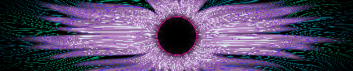
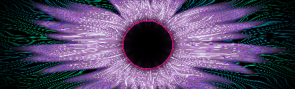
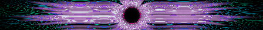

# Aether Flux · Frame-rendered cinematic plasma animation

> **Review only — no deployment or merge.** The previous weak SVG with moving stroke dashes was rejected and superseded. This is a new render system committed on the **same** feature branch.

Each GIF shows an evolving per-pixel plasma field. Every frame resynthesizes the full optical structure: a dark center, pink corona, cyan/teal filament field, turbulent petals, and changing illumination. There are no SVG dash animations. All three GIFs are directly embedded **as actual animations** below.

## Desktop animation · 448 × 90 · 20 frames

[Open actual desktop animation](../assets/profile-banners/premium-lab/01-aether-plasma-iris-top.gif)

## Mobile animation · 420 × 128 · 20 frames

[Open actual mobile animation](../assets/profile-banners/premium-lab/01-aether-plasma-iris-top-compact.gif)

## Bottom animation · 448 × 52 · 20 frames

[Open actual footer animation](../assets/profile-banners/premium-lab/01-aether-plasma-iris-bottom.gif)

### What changed

The previous collection animated moving bright sections along **static SVG lines**. This version animates the image contents across full raster frames, with deterministic evolving turbulence, moving pink/cyan field boundaries, changing filament curvature and a transformed volumetric field. A color-limited GIF still has visual limitations: it cannot reproduce HDR bloom or GPU-fluid realism. This is a visual experiment, not a claimed production-ready masterpiece.

- Source: [deterministic GIF renderer](../scripts/render-cinematic-plasma.cjs).
- Reproduction: `node scripts/render-cinematic-plasma.cjs --write`; verify with `--check`.
- No external assets or embedded scripts in GIFs.
- The old failed lab SVG triplet and its generator were deleted **only from this feature branch**, not from the live rotation.
- The live original Quantum Apex desktop/mobile SVGs and Evidence Horizon bottom SVG, 21 legacy SVG assets, eight-theme catalog, and `README.md` are preserved on `main`.
- Frame-based raster animation may be larger than acceptable for production; review movement and aesthetics first, then compress and provide reduced-motion handling before any rollout.

**DO NOT MERGE.** Owner visual approval is mandatory before further artwork or production integration.
