# Quantum Apex V2 — Luminous Singularity

> **Complete review-only V2 triplet — do not merge or activate without the owner's explicit approval.**
> This is an independent extension of merged V1 Photonic Depth, not a replacement for the approved
> content-addressed original. Every V1 path and the source original geometry are retained.
> The approved daily rotation, README, protected Spotlight publisher, manifests and approved original SVGs
> remain entirely unchanged.

## Visual review: V1 compared with V2

This triplet is a second-generation luminous simulation: higher spatial depth and prismatic material
separation, more refined highlights, crystalline armature, drifting caustic interference and
living photon flow. The transparent SVGs display most dramatically on the profile's black background.
**GitHub Markdown previews may be still frames; open each file directly to see the continuous motion.**

### 1. Desktop crown — full resolution 3840 × 774

**Merged V1 (baseline)**

**V2 Luminous Singularity — complete animated SVG**

[Full V2 desktop SVG](../assets/profile-banners/review/quantum-apex-luminous-singularity-v2-top.svg)

The center uses **ten-sided armature and articulated facet boundaries**, thin
micro-caustics, spectral highlights, multiple glass subsurfaces and coordinated
elastic core motion. Outer plasma waves wrap the still-recognizable signal lattice.
Point-scattered luminous fog and moving star photons create a sense of real light
rather than a succession of primitive lines.

### 2. Mobile crown — dedicated composition 1920 × 588

**Merged V1 (baseline)**

**V2 Luminous Singularity — complete animated SVG**

[Full V2 mobile SVG](../assets/profile-banners/review/quantum-apex-luminous-singularity-v2-top-compact.svg)

The 640 × 196 viewBox is independently authored. Fine optical fragments, central
crystal geometry and photon paths are arranged to survive real mobile scaling;
it is **not** a clipped or downsampled desktop banner.

### 3. Bottom evidence horizon — complete 3840 × 450

**Merged V1 (baseline)**

**V2 Luminous Singularity — complete animated SVG**

[Full V2 bottom SVG](../assets/profile-banners/review/quantum-apex-luminous-singularity-v2-bottom.svg)

The original evidence stream is preserved within matched spectral plasma membranes.
A lower-profile prismatic core, shallow refractive facets and phased photon trails
give the footer the same physical visual vocabulary without visually competing with
the more dominant crown.

## What distinguishes V2 from V1

| Quality | V1 Photonic Depth | V2 Luminous Singularity |
| --- | --- | --- |
| Principal sculpture | Hexagonal prism, nested lens | Multifaceted crystal armour, segmented optical trellis |
| Depth | Static/refraction glass fields | Multi-plane plasma membranes, particulate scattering, subsurface separation |
| Texture | Masked bounded mineral noise | Second independent mineral-noise pass and localized transparent foil fragments |
| Light | Soft bloom and caustic wave | Spectral rolling caustics, tight optical glints, overlapping emissive layers |
| Motion | Orbital rotation, refractive pulse, shape wave | Additional elastic central geometry, dual interfering deformations and travelling photons |
| Responsive | Dedicated compact arrangement | Dedicated V2 mobile geometry, intentionally distinct from desktop |
| Accessibility | Static reduced-motion treatment | Preserves all V1 reduced-motion layers and adds fully detailed V2 still state |
| Shipping | Already accepted on `main` as unactivated review art | **Not deployed. Owner review required.** |

## Safety, performance and contract

- **Everything is standalone** SVG, XML+SMIL, physically layered gradients, bounded blur
  and deterministic static microfacets; no scripting, foreign objects, external image
  references, CSS imports, embedded bitmap frames, or runtime dependencies.
- Existing aqua/green/magenta palette remains the foundation:
  `#00E6FF`, `#00FBCC`, `#E328FC`; near-white is only a sparse optical hot spot.
- Transparent background; no forced opaque panel.
- Fine atmospheric noise is clipped to the artwork and constrained to two octaves.
  Glow uses deliberately bounded SVG filter regions. This improves realism, but
  is **not** a validated performance benchmark; test real hardware before any activation.
- Every shape morph interpolates compatible SVG path command topology and closes
  at the starting frame. Base path renders without SMIL support.
- Reduced-motion mode disables both new V2 and inherited V1 kinetic layers; the
  intricate static glass and photon-field composition is retained.
- Full browser checks remain required: Safari macOS/iOS, Chrome desktop/Android,
  Firefox and LibreWolf, dark/light and reduced motion, 320px/375px/430px mobile,
  desktop 1280px/1440px and 4K.
- `python3 scripts/verify_quantum_apex_v2_review.py` is a read-only contract test
  for the V1-to-V2 exact blob lineage, static geometry, content, SMIL path topology,
  reduced-motion fallback and accidental deployment.
- No migration or production activation in this PR. Changing live rotation would
  require a **separate approval and governance process**: the pinned production original
  and three-day approved assets cannot be changed by merely adding this review set.

## Acceptance provenance and unique-code classification

- V1 accepted in **PR #1771**, merge `22d5f47ea6dd6ed27452cfbf9e1c16d36a9d473e`.
  This exact accepted `main` was used as the new V2 branch point.
- Accepted V1 Git blobs: desktop `4d783a9f32cc747e50db36312f8ae6d1894403f2`,
  compact `39f6298bfece3ef19ec8496a907869b7cecb2f59`, bottom
  `47c5b6cfce89a0ae1497749f1c5ef129f58739d5`. All remain unchanged.
- Original production art blobs: desktop `cba6be419ca838ada1accd02b714cd99fdd06664`,
  compact `7a9b12381c15fe6811e57af07a5569b15354c219`, bottom
  `de437b518adae0a8a501d4c6693b8a6b987576a2`.
- #1637 (`2e0ade0a1a073a824d77ebb599d89db453dd51d6`) and
  #1641 (`d9ab4446aefc27b71662ba0aeee8aee2355e4438`) remain intentionally
  historical, unmerged theme experiments. Their unique artworks are preserved,
  not silently conflated with the Quantum Apex lane.

**Please inspect these V2 images in motion. Leave the PR OPEN and UNMERGED.**
