# Quantum Apex — Photonic Depth / review-only visual gallery

> **Owner approval requested; do not merge or deploy this PR.** These are complete, independent
> responsive SVG files, **not fragments** and not replacements for the content-addressed production originals.
> The existing three-day production rotation, manifest and original files remain unchanged.
>
> These previews use transparent SVG canvases; their refractive light is designed to retain
> the legacy Quantum Apex silhouette and reads best against a dark background. GitHub may show a still frame
> rather than proving smooth animation; open the SVG files directly in Safari, Chrome, and Firefox/LibreWolf.

## Desktop crown — original vs living photonic candidate

**Approved original (preserved):**

**Photonic Depth candidate — complete UHD 3840 × 774, viewBox 1280 × 258:**

[Open full desktop SVG source](../assets/profile-banners/review/quantum-apex-photonic-top.svg)

The original signal paths, central two-tier crystalline command crown and kinetic signal trajectories
remain recognizable. The review artwork adds a physically inspired multi-layer light volume:
granular low-alpha plasma, nonuniform caustic interference ribbons, prismatic bevel/face highlights,
micrograin particulates, warm-white emissive hotspots with brand-colored halos, pulse breathing,
gently oscillating hexagonal armour, orbital rotation and a periodically reshaped waveform.
This is **not** a recolor or just an animated stroke pattern.

## Mobile crown — independently authored composition

**Approved original (preserved):**

**Photonic Depth mobile candidate — complete 1920 × 588, viewBox 640 × 196:**

[Open full mobile SVG source](../assets/profile-banners/review/quantum-apex-photonic-top-compact.svg)

Mobile retains a centered, readable crystalline reactor within the original narrower layout,
while simplifying the surrounding refractive glass. Grain, caustics, pulse and shapeshift
are tuned to the shorter canvas rather than cropping a desktop animation.

## Bottom evidence horizon — matched light physics

**Approved original (preserved):**

**Photonic Depth candidate — complete UHD 3840 × 450, viewBox 1280 × 150:**

[Open full bottom SVG source](../assets/profile-banners/review/quantum-apex-photonic-bottom.svg)

The original converging evidence lines remain; they now sit within shallow luminous plasma rivers,
multi-depth glass fragments, refractive highlight ribbons, a breathing convergent crystalline
nucleus and slowly morphing caustic wavefronts. The original non-clickable footer contract
is unchanged because this artwork is **not** referenced by the README.

## Rendering, accessibility and release boundary

- **No production integration:** files live solely in `assets/profile-banners/review/`; `README.md`,
  `scripts/approved-banner-rotation-v3.json`, the pinned source delegate, and all original/approved
  assets are untouched. Neither the selector nor publisher will accept unapproved art automatically.
- **No external resources or executable content:** self-contained XML+SMIL; no scripts, external
  images, CSS imports, remote fonts, data URIs or per-visitor JavaScript.
- **Transparent canvas** preserves the profile's existing dark/light page backgrounds.
  Colors use the established aqua `#00E6FF`, green `#00FBCC`, magenta `#E328FC`;
  white is restricted to tiny optical highlights.
- **Reduced motion** removes all new moving overlays and the original source's `.motion` animations,
  leaving an intentional, multi-layer static composition with facets, haze and softened caustics.
- **Browser compatibility:** SMIL, transforms, SVG radial/linear gradients and Gaussian blur.
  Animated `d` interpolation is progressive enhancement; the base path remains visible
  if a browser ignores it. `feTurbulence` is applied only to bounded clipped haze.
- **Review matrix:** Safari and Safari iOS, Chromium and Android, Firefox/LibreWolf;
  light/dark, still/reduced-motion, desktop 1280/1440 and mobile 320/375/430 CSS px.
  Static repository checks are not pixel-level or runtime animation proof.
- **Performance:** no bitmap, GIF, WebP or embedded image frames; three small standalone
  vector payloads (each below 48 KiB). Motion is staggered and slow, with bounded Gaussian
  blur and no full-page `filter: blur`.
- **QA command:** `python3 scripts/verify_quantum_apex_review.py` checks XML shape, complete
  payloads, local resource references, exact original provenance, static reduced-motion
  fallback, synchronized triplet inventories and continuous shape-morph interpolation.
- **Approval workflow:** review the source and real browser output first. A **future, separate,
  explicitly authorized production PR** would have to update immutable asset identities and
  protected source pins under the repository's guarded prior-authorization flow. This review
  PR must **not** be merged to accomplish deployment.

## Provenance of untouched originals

| Surface | Original Git blob (preserved) |
| --- | --- |
| Desktop | `cba6be419ca838ada1accd02b714cd99fdd06664` |
| Compact | `7a9b12381c15fe6811e57af07a5569b15354c219` |
| Bottom | `de437b518adae0a8a501d4c6693b8a6b987576a2` |

Unmerged experimental PRs #1637 and #1641 remain preserved in history; neither their
rejected art nor any of the other unapproved daily themes has been promoted.
