# Slot 04 · Lagrange Tides V2 — Opalescent Estuary

> **DO NOT MERGE OR DEPLOY WITHOUT OWNER VISUAL APPROVAL.**
> The live four-slot UTC rotation is already serving the approved V1 triplet;
> this V2 triplet is a self-contained review-only experiment with no live changes.

## Authentic V1 versus V2 artwork

The following link and preview files are the **actual complete SVG payloads**,
not simulated mockups. Depending on GitHub's preview surface, SMIL animation
may show a still frame: open the raw links directly for motion.

### 1 · Desktop crown — 3840 × 774

**V1, approved and live**

**V2, Opalescent Estuary**

[Open complete V2 desktop animation](https://raw.githubusercontent.com/portyu9/portyu9/review/slot4-lagrange-tides-v2-opalescent-estuary-20261018/assets/profile-banners/review/04-lagrange-tides-v2-opalescent-top.svg)

### 2 · Mobile crown — independent 1920 × 588

**V1, approved and live**

**V2, Opalescent Estuary**

[Open complete V2 mobile animation](https://raw.githubusercontent.com/portyu9/portyu9/review/slot4-lagrange-tides-v2-opalescent-estuary-20261018/assets/profile-banners/review/04-lagrange-tides-v2-opalescent-top-compact.svg)

### 3 · Closing evidence horizon — 3840 × 450

**V1, approved and live**

**V2, Opalescent Estuary**

[Open complete V2 bottom animation](https://raw.githubusercontent.com/portyu9/portyu9/review/slot4-lagrange-tides-v2-opalescent-estuary-20261018/assets/profile-banners/review/04-lagrange-tides-v2-opalescent-bottom.svg)

## Why this is a real V2, not more primitive lines

This new generation retains every original V1 glass-tide and plasma-ribbon
path, then constructs additional depth *on top of the real original artwork*:

- **Living liquid glass:** translucent multi-layer opalescent refraction with
  off-axis chromatic reflections, nonuniform caustic blooms, and translucent
  membranes. The effect is material/volume, not a simple border-only shape.
- **Cellular glass reef:** dozens of asymmetrical organic cubic-Bézier
  light-trapping facets; specular rims refract aqua, mint, violet, orchid
  and sparse moon-white optical peaks.
- **Fluid microsurface:** static seeded two-octave fractal noise driving a
  very small, bounded `feDisplacementMap`. The displacement is applied
  only to the clipped fluid membrane, not the entire canvas.
- **Emissive deposition:** 41–72 small offset micro-droplets per surface
  with internal refractive surfaces, 72–120 independent micro-caustic
  filaments, soft spectral scatter and tiny focal glass glints.
- **Smooth elastic light motion:** adds two independent 4-keyframe
  interpolable wave-morphs per surface (six in total including V1);
  4–5 additional guided photons (8–9 total) and dual counter-moving
  interference scan lines. A soft tide envelope slowly breathes.
- **Constrained accessibility:** V1's complete static fallback and kinetic
  group stay unchanged; V2 kinetic group is separately disabled under
  `prefers-reduced-motion`. V2 material and its static refractive
  crescent lines remain visible, with meaningful title/description.
- **True compact geometry:** mobile has its own 640×196 compositional
  envelope, 46 glass facets and fewer moving photons and tracer details;
  it isn't merely a cropped 1280px desktop animation.

### Exact Git content identities

| Surface | Accepted V1 blob | New V2 review blob | New UTF-8 bytes |
| --- | --- | --- | ---: |
| Desktop | `be373e0a4b601ae4f136797e2ddb96ea519d8f36` | `87507b866caf359a6c3edfc76c06ad97f539ddc5` | 184,409 |
| Mobile | `34cf94c290e16bc0c02704f4c7b79a5fdb3f4fe1` | `e7234689af9d29767fc8f6f1b7c0b9cddb14f874` | 141,728 |
| Bottom | `8b8719635237cc9bbb785bd2dc20d38479a0a009` | `57aae2dd4919fc9ffdf848dd85eb4d0bcc659bf4` | 162,094 |

## No-deploy and performance contract

This PR changes only three new `assets/profile-banners/review/` SVG
assets, this gallery, and `scripts/verify_slot4_lagrange_v2_review.py`.
It **does not change** `README.md`, any approved catalog, trusted
selector, protected publisher, workflows, V1 production artwork, V1
review sources, other approved slots, historical originals, or
the signed `generated` branch.

A new four-slot profile rotation was separately authorized in #1781,
merged as #1779, and published through README-only bot #1782 to accepted
`main@4cc5f5641dab3be3822cc15837ae3b231cd67de3`.
Slot 4 is currently **V1**, not V2. Owner approval of this new visual
is a prerequisite to any future guarded promotion.

There is a **performance tradeoff**: V2 uses more cubic curves, static
noise displacement and emission layers than V1. Source checks and CI
cannot prove real mobile frame time, LibreWolf rendering or aesthetic
quality. Review on desktop Safari/Chrome/Firefox, LibreWolf and real
Android/iOS, with reduced motion and GitHub light/dark backgrounds.
The bounded distortion is static and no JavaScript, remote images,
GIFs or external CSS is used.

Run `python3 scripts/verify_slot4_lagrange_v2_review.py` for exact
source, unchanged approved catalog, V1 path preservation, XML safety,
SMIL interpolability, reduced-motion fallback and no accidental
README deployment assertions.

## Mandatory lineage-and-salvage preflight

At V2 branch creation: accepted
`main@4cc5f5641dab3be3822cc15837ae3b231cd67de3`,
**zero open PRs**, and only `main` and independent signed
`generated@1140b616437ab94d9f7fb1d6a1795b3bd396961a`
branches. Unique V1 code and tests from #1777 were already accepted.
The exact four-slot selector/manifest from #1779 were already
accepted and bot #1782's README was already fully merged.

Historical unmerged art experiments #1637 at
`2e0ade0a1a073a824d77ebb599d89db453dd51d6` and
#1641 at `d9ab4446aefc27b71662ba0aeee8aee2355e4438`
are **superseded but preserved** in history. There was no pending
V2 Tides branch, and no unique old V2 Tides functionality to salvage.
Open issue #1659 concerns independent Dependabot zero-touch
automation; GHAS alert inventory is not accessible through the
linked GitHub integration.

**PR remains OPEN and NON-DRAFT until visual signoff.**
