# Lagrange Tides V3 — Kinetic Braided Currents

> **VISUAL REVIEW ONLY — DO NOT MERGE OR ENABLE V3 UNTIL OWNER APPROVAL.**
> The accepted production four-day rotation continues to serve **Tides V1**.
> V2 was merged as additive review artwork in #1783, but is not silently active.

This iteration has a different engineering objective: **the glass itself moves**.
It is not a third static texture pass. The accepted V1 and V2 sculptures are
present in full as the deep stationary physical world. V3 adds an independently
moving interference engine on top, with two counter-flowing **translucent
glass-plasma volumes** that actually change their cubic-Bézier contours, travel
horizontally in opposite phases, alternate which ribbon is *in front*, and
carry dozens of moving emitters, caustic seams, wave filaments and light trails.

## See the actual animated artwork — every surface

**Desktop • 3840 × 774 • independent 1280 × 258 geometry**

[Open the full desktop animation](https://raw.githubusercontent.com/portyu9/portyu9/review/slot4-lagrange-tides-v3-kinetic-braided-currents-20261019/assets/profile-banners/review/04-lagrange-tides-v3-kinetic-top.svg)

**Mobile • 1920 × 588 • purpose-designed 640 × 196 geometry**

[Open the full mobile animation](https://raw.githubusercontent.com/portyu9/portyu9/review/slot4-lagrange-tides-v3-kinetic-braided-currents-20261019/assets/profile-banners/review/04-lagrange-tides-v3-kinetic-top-compact.svg)

**Closing evidence horizon • 3840 × 450 • independent 1280 × 150**

[Open the full closing animation](https://raw.githubusercontent.com/portyu9/portyu9/review/slot4-lagrange-tides-v3-kinetic-braided-currents-20261019/assets/profile-banners/review/04-lagrange-tides-v3-kinetic-bottom.svg)

*GitHub's Markdown thumbnail or a browser in restrictive SVG settings
may render a still image; the raw links contain live SMIL animations.*

## Design progression — review the genuine files

| Surface | V1 — Living Photonic Estuary | V2 — Opalescent Estuary | V3 — Kinetic Braided Currents |
| --- | --- | --- | --- |
| Desktop | [Original 3D lightfield](../assets/profile-banners/review/04-lagrange-tides-top.svg) | [Glass reef and caustics](../assets/profile-banners/review/04-lagrange-tides-v2-opalescent-top.svg) | [Moving twin glass tides](../assets/profile-banners/review/04-lagrange-tides-v3-kinetic-top.svg) |
| Mobile | [Purpose-composed V1](../assets/profile-banners/review/04-lagrange-tides-top-compact.svg) | [Refractive V2](../assets/profile-banners/review/04-lagrange-tides-v2-opalescent-top-compact.svg) | [Responsive kinetic V3](../assets/profile-banners/review/04-lagrange-tides-v3-kinetic-top-compact.svg) |
| Bottom | [V1 refractive wake](../assets/profile-banners/review/04-lagrange-tides-bottom.svg) | [V2 glass/reef depth](../assets/profile-banners/review/04-lagrange-tides-v2-opalescent-bottom.svg) | [V3 animated wake](../assets/profile-banners/review/04-lagrange-tides-v3-kinetic-bottom.svg) |

## V3 movement — observable, not asserted

**Structural geometry and spatial movement**

1. **Twin deforming volumes:** both streams contain synchronized cubic
   body-morphs with four spline-interpolated, topologically compatible frames
   per cycle. The ribbons constantly narrow, shear and widen while maintaining
   glass depth. Static V1/V2 remains underneath.
2. **Independent counter-translation:** each stream's deep-glass layer,
   foreground refraction layer and live caustic seam move in opposing
   horizontal/vertical phases, offset by different rhythmic periods.
3. **True weave alternation:** independently moving `clipPath` windows allow
   the two surfaces to *exchange foreground priority* along the estuary.
   The windows themselves glide horizontally to move the crossing highlights.
   Desktop and footer have seven windows **per stream**; mobile has five per
   stream to avoid visual noise at 640px.
4. **Deep atmospheric parallax:** three offset luminous nebula volumes
   translate slowly in different phases behind the current layers.
5. **Filament countercurrent:** thread beds move ±8–10 SVG units against the
   streams, with traveling dash energy and spatial opacity breath.

**Light and timed transport**

6. **Ion traffic:** V3 adds **15 independently timed photons** on desktop,
   **9 on mobile**, **12 in the footer**, in addition to the existing V1/V2
   photons. Each has a multi-layer flare/trailing light and travels
   along a real curved path.
7. **Photonic caustics:** twin elastic seam morphs per stream carry broad
   blurred underlight, fine spectrum highlights and moving spectral dash
   interference, with no JavaScript or linked image resources.
8. **Plasma breathing:** 18 desktop, 12 mobile, 14 footer microenergy emitters
   expand and brighten cyclically at different phase offsets. Flowing
   glints, nebula brightness, ribbon volume opacity and emitter radii
   modulate at independent frequencies.

**Smoothness / reduced-motion discipline**

- Animated groups do **not** request per-frame turbulence seed, noise
  octave, expensive whole-canvas blur, or full-frame filter recalculation.
  Both existing noise filters stay static; glow filters are local to fine
  energy paths or small moving ion points.
- Group translation uses SVG `animateTransform` while ribbon volume
  changes use interpolable `animate d` with four closed easing frames.
  No CSS transform-origin Safari/LibreWolf dependency and no remote assets.
- The V3 kinetic group is independently gated under
  `prefers-reduced-motion: reduce`. Accepted V1's static fallback and V2
  glass/texture/material layers remain visible when movement is disabled.
- This is a deliberate, complex, high-motion SVG scene; Firefox/LibreWolf,
  Safari and physical mobile GPU frame times are **not** established by
  CI. Test raw animated files at 1× and 3× and on actual phones. If memory
  bandwidth or frame rate is poor, reduce moving glows/photons before
  promotion rather than reducing geometry to simple lines.

## Exact source inventory

| Surface | Accepted V2 input blob | New V3 Git blob | V3 bytes | Morphs total | New translations | New guided photons |
| --- | --- | --- | ---: | ---: | ---: | ---: |
| Desktop | `87507b866caf359a6c3edfc76c06ad97f539ddc5` | `b1c0b6ccc5449b497c54cafdaf2f2fbb0cf47c4e` | 290,338 | 16 | 11 | 15 |
| Mobile | `e7234689af9d29767fc8f6f1b7c0b9cddb14f874` | `4c6b27abb8e7d9a5d0d93e35e1f3b9dc725d1a5a` | 224,811 | 16 | 11 | 9 |
| Bottom | `57aae2dd4919fc9ffdf848dd85eb4d0bcc659bf4` | `5684296283fb7b51c32521388a8bc282de66c1d7` | 254,733 | 16 | 11 | 12 |

Every V2 `<path d=...>` is retained verbatim. The V3 layer increases
the SVG size because it adds actual Bézier geometry and timed animation
rather than referencing an uncommitted generator or a static mockup.
Color palette remains the accepted cyan/mint/violet/orchid/white dark-glass
treatment, with accessible title and description.

## Scope, lineage and deployment boundary

**Exactly five new files** on this review branch: three real SVGs, this
gallery and the read-only verifier
`scripts/verify_slot4_lagrange_v3_review.py`.

No change to README, `approved-banner-rotation-v5.json`,
`approved_banner_rotation.py`, protected Spotlight publisher,
workflows, active source paths, original V1/V2 SVGs, old catalogs,
security controls or signed `generated` branch. V3 remains
**review-only and not in the four-day rotation**. User approval of V2's
review merge was not approval to deploy it, nor approval to deploy V3.

Formal lineage/salvage preflight immediately before branching:

- Accepted `main@943e0d9870e16fe0cf9820314ad78a065dc8ca49`,
  with merged V2 PR #1783. Complete V1 (#1777), V2 (#1783), selector
  (#1779) and README governed publication (#1782) capabilities were
  already accepted, with no unique code stranded behind.
- Zero open PRs and no open bot PRs. Branches were exactly
  `main` and independently signed
  `generated@1140b616437ab94d9f7fb1d6a1795b3bd396961a`.
- Archived, rejected #1637 prototype at
  `2e0ade0a1a073a824d77ebb599d89db453dd51d6` and #1641
  experimental plasma GIF at
  `d9ab4446aefc27b71662ba0aeee8aee2355e4438` remain
  historically preserved, not promoted or copied.
- Unrelated open issue #1659 concerns Dependabot automation. Sensitive
  GHAS code-scanning-alert inventory unavailable via the connector.

Run `python3 scripts/verify_slot4_lagrange_v3_review.py` from the
review checkout for fail-closed exact blobs, XML, local paint refs,
all V2 path preservation, compatible closed-loop morphs, positive
translation and flowing clip-window counts, reduced-motion fallback,
and production no-deployment assurance.

### Owner visual acceptance

Please compare **real moving frames** in Safari, Chrome, Firefox and
LibreWolf plus iOS/Android on a true device. Specifically assess whether
both ribbons actually weave rather than merely flicker, photons translate
visibly, large glass volumes pulse without obscuring detail, transition
loops have no snapping, reduced motion shows the complete static sculpture,
and motion is comfortable at phone resolution.

**Keep the V3 PR OPEN, NON-DRAFT, UNMERGED until the owner explicitly approves.**
