# Fractal Iris — offline cinematic render study (not approved)

This is the first **isolated, deliberately unshipped** attempt to replace geometric SVG animation with evolving volumetric raster texture. It is neither a claim of physical accuracy nor a finished state-of-the-art treatment. Production remains pinned to original Quantum Apex/Evidence Horizon. The seven daily SVG triplets are preserved unchanged.

## GitHub-hosted animated SVG preview

**[Open the actual Fractal Iris animated SVG in GitHub](previews/fractal-iris-animated.svg)** · **[Open the raw SVG animation](https://raw.githubusercontent.com/portyu9/portyu9/feature/volumetric-iris-render-study-20261013/experiments/previews/fractal-iris-animated.svg)**



The preview above is the **actual committed animated SVG**, not a sandbox link or a mockup. If GitHub's Markdown image proxy shows a static frame, open the raw link in your browser to review motion. This is a separate **SVG-native filter and turbulence study**, not an exact conversion of the Python WebP renderer below. Visual/performance approval is outstanding; SVG turbulence can be expensive on slower browsers. **This approved version is the source for production Fractal Iris slot 2. Publication is governed by the protected eight-slot Spotlight publisher; this experiments file is retained as the audit/reference original.**

## Original-motion restoration — October 13

**[Review the committed animated SVG](previews/fractal-iris-animated.svg)** · **[Play actual motion using the raw GitHub SVG](https://raw.githubusercontent.com/portyu9/portyu9/feature/volumetric-iris-render-study-20261013/experiments/previews/fractal-iris-animated.svg)**

The previous iterations incorrectly substituted motionless original elements with animated light overlays. That approach has been removed. This revision animates **all 165 exact original spaghetti paths**, the **four original blurred, warped nebula paths**, and the **two original filtered turbulence textures**; it retains the improved dimensional central iris unchanged. The original spaghetti and nebula path tags have been verified byte-for-byte against the earlier SVG blob `e667594c4b0b79f0457fe57589f0ec990c776092`.

**Motion implementation:** Original filament paths are stored once in five internal SVG geometry groups (33 paths each); original warped nebula contours are stored once in four groups; the original cyan and magenta noise textures remain unchanged as geometry. The animation operates on the actual original groups via internal `<use>` instances rather than separate imitation trails. Each original group moves with a closed back-and-forth `animateTransform` curve and cubic ease-in/out (`keyTimes="0;.5;1"`, `keySplines=".42 0 .58 1;.42 0 .58 1"`). This makes position **and slope/velocity continuous at each reversal and at the loop reset**, eliminating the former instantaneous reversal in the 19-second filament rotation. Five intertwined spaghetti groups rotate subtly in 23–41 second cycles, four nebula contours drift in 23–37 second cycles, and the original two noise textures drift in 34/39-second cycles. The existing three optical iris rotations remain 53/71/96 seconds.

**What stays fixed:** The costly SVG turbulence and displacement *parameters* never change during playback. The static noise material and blurred source remain identical to the original animation's appearance; the scene bodies move over them. The intrinsic SVG size remains 1280 × 258 rather than the earlier oversized 3840 × 774. Every moving original group has a paired static geometry instance shown for `prefers-reduced-motion`, so reduced-motion users retain the same full composition.

**Assurance:** `python3 experiments/validate_iris_svg.py` pins the original path inventory with source fingerprints, checks that all 11 original nebula/filament groups actually move, verifies closed position/velocity easing, keeps the multi-layer iris, and blocks animated filters and synthetic dash-highlight replacements. This is a **source-structure and mathematical continuity test**, not a measured frame-rate test. Browser-renderer performance and artistic signoff remain unverified; keep this study outside the README and outside the production rotation until reviewed.

## Nebula luminosity and corona pulse — second visual review

**Watch the actual [review SVG in GitHub](previews/fractal-iris-animated.svg)** or [play the raw animated SVG](https://raw.githubusercontent.com/portyu9/portyu9/feature/volumetric-iris-render-study-20261013/experiments/previews/fractal-iris-animated.svg).

The cloud contours were previously moving too slowly and at nearly constant brightness to read as alive. This revision preserves the original geometry and enhances all six **real nebula bodies** rather than substituting overlay bands. The four original filtered cloud contours now make larger, more legible 13/17/19/23-second closed drifts and independently breathe from 26–42% opacity to 94–100%, with 7/8/9/11-second illumination cycles. The two original noise-texture layers drift over 18/21 seconds and breathe over 10/12-second cycles. Their spectral texture, turbulent displacements and blur parameters are **not animated**.

The glow centered around the existing iris gains three phase-staggered, broad, soft radial-gradient plasma coronas (magenta, cyan, violet), independently expanding/contracting and visibly fading/pulsing over 8/11/13 seconds. Corona shapes have no costly SVG filters and all animations use matched-start/end cubic eased loops; the iris's 16 original blades, 18 petals and all 165 moving spaghetti paths remain unchanged. All nine brightness pulses begin at staggered points in their cycles, so the first frame already shows energized atmosphere rather than simultaneous darkness; each corona's scaling remains synchronized with its brightness. Each corona also has a still version for reduced-motion preferences. The superseded surrogate filament-highlight and neon-band assets are absent.

Use `python3 experiments/validate_iris_svg.py` for static checks: original geometry hashes, 11 original moving groups, strong optical/nebula opacity variation, 3 core glow layers, smooth closed loops, and 3 corresponding static corona fallbacks. It **does not measure browser frame cadence** or establish a guarantee about GitHub's inline SVG animation behavior. Artistic review and browser-level playback remain required before any merge or production activation.

## Final optical interaction study — nebula-driven lens caustics

[**View current animated SVG in GitHub**](previews/fractal-iris-animated.svg) · [**Play the actual SVG in a browser**](https://raw.githubusercontent.com/portyu9/portyu9/feature/volumetric-iris-render-study-20261013/experiments/previews/fractal-iris-animated.svg). GitHub's inline SVG preview may appear static; use the raw link for motion.

**Why this matters:** The current nebula and iris each animate correctly, but without shared light interaction they can look like stacked graphics. This revision makes the **existing magenta, cyan and violet atmospheric pulses illuminate three separate curved sectors of the actual iris rim**. Each localized caustic consists of an understated broad scattering fringe, a narrow bright contact reflection, fine secondary diffraction, a small plasma-to-rim contact streak and a tight specular glint. The highlighted locations subtly rotate through a few degrees instead of spinning entire rings. The under-iris shadow crescents were explicitly rejected during visual review and have been removed. The synchronized rim caustics remain.

**Coupling, not more arbitrary animation:** The chromatic highlight for each color copies its corresponding *existing corona* opacity envelope, duration and negative phase offset **exactly**: magenta `8s/-3s`, cyan `11s/-5s`, violet `13s/-7s`. Its minor angular excursion shares the same period and phase. Each cycle uses matched start/end positions and spline easing. The underlying 165 original spaghetti paths, four original nebula contour paths, two moving turbulence fields, nine prior atmospheric pulses and complete 16-blade/18-facet iris assembly are unchanged.

**Safety, depth and accessibility:** Only small, unfiltered vectors and static linear/radial gradients were added, and **no under-iris shadow crescents**. There are no additional animated turbulence, displacement, blur, or giant filtered paint groups. The three optical highlight groups each have a geometry-identical static counterpart selected by `prefers-reduced-motion`. The original accepted iris section is pinned to source fingerprint `f95760d1`, and `python3 experiments/validate_iris_svg.py` checks exact pulse-to-corona phase linkage, geometry identity, absence of rejected under-iris shadows, closed movements and reference integrity. Verification is source-level, not proof of smooth GPU/browser playback.

**Publication sequence:** The approved artwork is staged for slot 2 with content-pinned desktop/mobile/footer variants. A separate, reviewed exact trusted-source authorization merged as PR #1649 before the production PR can merge. The protected Spotlight publisher—not this experimental script—must author the daily README-only rotation. Original Quantum Apex and Evidence Horizon assets stay preserved; the six reserved slots fall back to original artwork.

## Frame renderer

Requires Python 3.11+ plus Pillow, NumPy and OpenCV (headless). Run after installing these packages in a local isolated environment:

```bash
python3 experiments/fractal_iris_pilot.py --self-test
python3 experiments/fractal_iris_pilot.py --output /tmp/iris-review.webp
python3 experiments/fractal_iris_pilot.py --output /tmp/iris-keyframe.png
```

The isolated study uses transported multiscale stochastic turbulence, a nonlinear emission/density field, evolving aperture corona, spatially layered bloom and a bounded filmic curve. Source frame count, animation duration, output dimensions, and no-overwrite behavior are bounded. Reduced-motion content can use the generated static PNG.

## Acceptance gate before any production or reactivation

1. **Visual:** compare actual moving frames with the approved original Quantum Apex desktop and compact art. A merely animated contour/wireframe is a failed iteration. Review at desktop and narrow mobile aspect ratios and footer proportions, including reduced motion.
2. **Runtime:** verify GitHub README image playback behavior, first-view loading, transferred bytes, decoded memory, mobile frame cadence, and motion/cross-browser behavior. Report measured results, not theoretical guarantees.
3. **Security:** no README publisher changes, no external loads, no hidden script, no automatic merge of artwork, and no rotation reactivation without a separate explicit PR and owner signoff.
4. **Coverage:** when the first render is genuinely approved, build six separately directed scenes (Orbital Relay, Prism Vault, Neural Weave, Spectral Tides, Circuit Basilica, Singularity Mesh) and distinct desktop/mobile/footer compositions.

Current study is **not accepted artwork**. Keep this PR available for code iteration and review, but do not merge or deploy unfinished imagery.

## Initial visual evaluation (not acceptance)

Locally rendered study sample: 960 × 194, 32 frames, 112 ms per frame (~3.58 seconds), animated WebP approximately 273 KB. It introduces evolving gas texture rather than simply animating geometrical line drawings, but its central aperture and magenta cloud field are **still too schematic to qualify as the final cinematic design**. The model is artistically provisional. No actual GitHub animation playback, browser frame-time, memory, or mobile/compact/footer verification has been performed. The next iteration must materially improve material realism, dimensional atmosphere, and scene composition before product integration.
