# Four animated banner families — visual review only

**No activation or production merge is authorized.** All approved legacy and current slots remain byte-for-byte unchanged; the daily rotation is unaffected.

| Family | Wide (1280 × 258) | Compact (640 × 196) | Footer (1280 × 150) |
|---|---|---|---|
| Living Plasma |  |  |  |
| Cybernetic Cathedral |  |  |  |
| Quantum Interference |  |  |  |
| Celestial Singularity |  |  |  |

## Quality constraints and next gate

- Each of the 12 files is a generated, original, self-contained animated SVG with real path geometry, embedded CSS/SMIL motion, no external assets, and reduced-motion still fallback.
- `python3 experiments/banner-v3/generate.py --check` verifies deterministic generation, path-density bounds, XML parse, and script-free assets. `python3 experiments/banner-v3/generate.py` regenerates assets in the same directory.
- Visual review requires inspection of actual animation frames and geometry for each of desktop, compact mobile, and footer. The raster contact sheets provided in the conversation are snapshots only, not real-device testing.
- No files in `assets/profile-banners/approved`, no approved catalog, no README, workflows, generated evidence or delegated source contracts changed.
- Do not merge this review PR without express art approval and a separate governed production activation PR.
