# Chronohedron — concept 3 kinetic crystal reactor

**Status: NEW VISUAL STUDY ONLY. Not approved or active in the profile's daily eight-slot rotation.** Its intended target is a future, separately authorized slot 3 only after owner visual acceptance. The current real slot 3 remains reserved and renders original Quantum Apex.

This visual is not a recolor, clone or reskin of the Fractal Iris. Its main silhouette is a transparent, deeply faceted six-sided suspended crystal around a glowing photonic energy cavity. Both sides are architectural optical waveguide arrays funneling through the crystal and across narrow cyan/amber grazing reflections. Independent polyhedral cages and layered inner faceting create a 3D-like parallax without turbulent filters or disruptive resets.

## Inspect actual committed SVG artwork

### Wide desktop — 1280 × 258

[Open actual SVG / raw browser playback](https://raw.githubusercontent.com/portyu9/portyu9/feature/chronohedron-crystal-reactor-study-20261013/experiments/previews/chronohedron-top.svg)

### Mobile center crop — 640 × 196

[Open actual compact SVG / raw browser playback](https://raw.githubusercontent.com/portyu9/portyu9/feature/chronohedron-crystal-reactor-study-20261013/experiments/previews/chronohedron-top-compact.svg)

### Footer horizon — 1280 × 150

[Open actual footer SVG / raw browser playback](https://raw.githubusercontent.com/portyu9/portyu9/feature/chronohedron-crystal-reactor-study-20261013/experiments/previews/chronohedron-bottom.svg)

GitHub's Markdown image proxy may freeze an SVG's SMIL animation. Open the raw link in an ordinary browser to assess real motion, lighting, device behavior and perceived depth.

## Original art systems and material recipe

- **Crystal architecture:** More than 100 actual SVG polygons form prismatic membranes, diffuse cyan glass, warm amber internal refraction, specular facets and nested energy cells. The external optical cages are geometric 3D-style wireframes, not smooth iris rings.
- **Energy pathways:** Two banks of physical cubic Bézier glass waveguides descend from the edges toward the reactor. Four motion zones per bank sway by a few pixels with independent 16–31 second rhythms. Dense ghost perspective lines suggest architecture vanishing into the structure, rather than another field of cosmic noodles.
- **Counter-phase parallax:** Fourteen transformed groups include the waveguide banks, inner facets, orthogonal cage structure, crystal hull, moving glass caustics and core energy. Each movement closes on the original pose through a smooth cubic spline. Twelve energy/illumination envelopes follow their parent transforms.
- **Refraction and depth:** The central reactor contains thin high-frequency ice-blue and champagne-gold edge caustics; luminous internal slivers shift and brighten behind separate glass facets. A pair of small static Gaussian filters provides selective softness; **no filter parameters animate**.
- **Motion/accessibility:** All 14 moving groups have geometry-identical static fallbacks under `prefers-reduced-motion: reduce`. There is no JavaScript, embedded image, external resource, animated SVG noise, or dynamic blur.
- **Responsive parity:** Exactly the same scene geometry is used for desktop, compact and footer. Only viewport/crop and accessible title differ. Visual crop and actual browser frame pacing remain review criteria, not proven facts.

## Assurance and isolation

Run `python3 experiments/validate_chronohedron_svg.py` to validate unique SVG IDs, balanced XML, matching geometry among all three crops, density thresholds, accessible titles and descriptions, 14 seamlessly closed motion loops, 14 paired static fallbacks, zero external payloads and constrained geometry size.

**Approval gate:** This PR must stay open and unmerged until you approve the actual visual. No changes to the already approved Fractal Iris files, original Quantum Apex/Evidence Horizon assets, the eight-day selector, the generated evidence branch or the production README are permitted from this lane.
